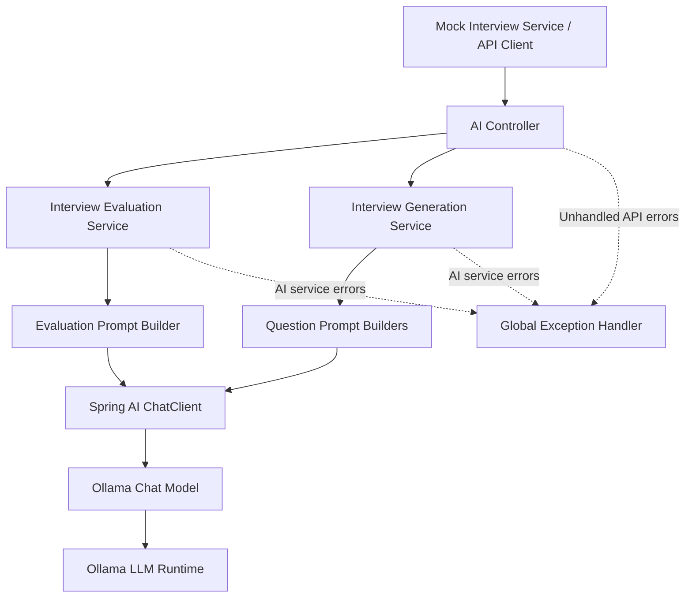

# AI Service — EduPilot & ContestArena

The **AI Service** is a dedicated microservice within the combined EduPilot and ContestArena platform. It provides AI-powered capabilities for mock interviews by generating interview questions dynamically and evaluating interview performance using a configured Large Language Model (LLM).

Built with **Java, Spring Boot, Spring AI, and Ollama**, the service separates AI processing from the core application services, allowing interview-related AI functionality to be maintained and extended independently.

## Features

- **Initial Question Generation:** Generates the first question based on the interview configuration and instructions.
- **Dynamic Question Generation:** Generates subsequent interview questions using the current interview context.
- **AI-Powered Interview Evaluation:** Evaluates interview responses and produces a structured evaluation.
- **Prompt Engineering:** Uses dedicated prompt builders to construct prompts for question generation and interview evaluation.
- **Structured AI Responses:** Maps AI-generated output to Java response DTOs using Spring AI.
- **Centralized Exception Handling:** Provides consistent API error responses for validation failures, AI service exceptions, and unexpected errors.
- **LLM Integration:** Uses Spring AI abstractions to communicate with the configured language model, including an Ollama-backed implementation.

## Technology Stack

| Technology | Purpose |
|---|---|
| Java | Primary programming language |
| Spring Boot | Application framework |
| Spring AI | Integration with language models |
| Ollama | Local LLM runtime |
| Spring Web | REST API development |
| Jakarta Validation | Request validation |
| Maven | Dependency management and build automation |

## Architecture

The AI Service exposes REST endpoints for interview-related AI operations. It builds prompts using dedicated prompt builders, communicates with the configured language model, and returns structured responses to its caller.



### Request Processing

1. The calling service sends a request to an AI Service REST endpoint.
2. `AiController` delegates the request to the appropriate service.
3. The service builds a prompt using the corresponding prompt builder.
4. Spring AI sends the prompt to the configured language model.
5. The generated output is mapped to the relevant response DTO or returned as text.
6. The controller returns the result to the caller.

## REST API Endpoints

Base path: `/ai/v1`

| Method | Endpoint | Description |
|---|---|---|
| POST | `/initial-question` | Generates the initial mock interview question. |
| POST | `/next-question` | Generates the next question for an ongoing interview. |
| POST | `/interviews/evaluate` | Evaluates an interview and returns a structured evaluation. |

### 1. Generate Initial Question

`POST /ai/v1/initial-question`

Generates the first question using the supplied interview configuration.

**Request body:** `InitialQuestionRequest`

The request fields and validation requirements are defined by the `InitialQuestionRequest` DTO.

**Response:** `InitialQuestionResponse`

Returns the initial question and associated interview metadata as defined by the response DTO.

### 2. Generate Next Question

`POST /ai/v1/next-question`

Generates the next question based on the current interview context.

**Request body:** `NextQuestionRequest`

The request contains interview context and question-limit information.

**Business rule:** Question generation is rejected when the number of questions already asked reaches or exceeds the configured question limit.

**Response:** `NextQuestionResponse`

Returns the generated question.

### 3. Evaluate Interview

`POST /ai/v1/interviews/evaluate`

Evaluates the submitted interview information using an AI-generated assessment.

**Request body:** `InterviewEvaluationRequest`

Contains the interview data required by the evaluation prompt builder.

**Response:** `InterviewEvaluationResponse`

Returns the structured evaluation defined by the response DTO.

> For exact JSON request and response examples, refer to the corresponding DTO classes. This README does not assume fields that have not yet been verified.

## Project Structure

The following is a logical overview based on the classes provided. Package names and additional folders may differ in the actual source tree.

```text
ai-service/
├── src/
│   └── main/
│       ├── java/
│       │   └── .../
│       │       ├── controller/
│       │       │   └── AiController.java
│       │       ├── service/
│       │       │   ├── InterviewEvaluationService.java
│       │       │   ├── InterviewServiceImpl.java
│       │       │   └── OllamaService.java
│       │       ├── exception/
│       │       │   ├── GlobalExceptionHandler.java
│       │       │   ├── AiServiceException.java
│       │       │   └── ErrorResponse.java
│       │       ├── prompt/
│       │       │   ├── InterviewEvaluationPromptBuilder.java
│       │       │   ├── InterviewGenerationPromptBuilder.java
│       │       │   └── InitialQuestionPromptBuilder.java
│       │       └── dto/
│       │           ├── request/
│       │           └── response/
│       └── resources/
│           └── application.yml
└── pom.xml
```

## Setup and Installation

### Prerequisites

- Java version supported by the project's Spring Boot configuration (Java 17 or later is typical).
- Maven.
- Ollama installed and running.
- A language model downloaded in Ollama.
- The project's required Spring AI and Ollama dependencies configured in `pom.xml`.

### 1. Clone the Repository

```bash
git clone <your-repository-url>
cd <repository-directory>
```

Navigate to the AI Service module directory.

### 2. Configure Ollama

Start Ollama and download a model supported by your Spring AI configuration.

For example:

```bash
ollama pull llama3.2
```

Ensure the model name matches the model configured in the application.

### 3. Configure Application Properties

Configure the Ollama connection and model in `application.yml` or `application.properties`.

Example configuration for Spring AI versions supporting these property names:

```yaml
spring:
  ai:
    ollama:
      base-url: http://localhost:11434
      chat:
        options:
          model: llama3.2
```

Check your project's Spring AI version and existing configuration before applying these settings.

### 4. Build the Service

```bash
mvn clean package
```

### 5. Run the Service

```bash
mvn spring-boot:run
```

Alternatively, run the generated JAR:

```bash
java -jar target/<generated-jar-name>.jar
```

The application will start on the port configured for the AI Service. Use that port when calling the endpoints listed above.

## Error Handling

The service uses `GlobalExceptionHandler` to standardize API errors.

| Exception | HTTP status | Purpose |
|---|---:|---|
| `MethodArgumentNotValidException` | 400 Bad Request | Request validation failed. |
| `AiServiceException` | 503 Service Unavailable | An AI-related operation failed. |
| Other unhandled exceptions | 500 Internal Server Error | An unexpected server-side error occurred. |

Error responses use the `ErrorResponse` DTO, which contains a timestamp, HTTP status code, and message.

The generic exception handler returns a generic client-facing message rather than exposing internal implementation details.

## Design Considerations

- **Separation of concerns:** REST controllers, prompt builders, and AI service classes have distinct responsibilities.
- **Model abstraction:** Spring AI provides an abstraction for interacting with the configured language model.
- **Question-limit enforcement:** The next-question generation method checks the configured question limit before invoking the model.
- **Structured output:** Interview evaluation and initial-question generation use response DTOs to represent model output.
- **Error isolation:** AI-related failures are wrapped in a service-specific exception and handled centrally.

## Future Enhancements

Potential improvements for future iterations include:

- Add integration tests for the AI endpoints and prompt-generation workflows.
- Add timeouts and resilience mechanisms for slow or unavailable LLM responses.
- Improve handling of malformed or incomplete model output.
- Add request correlation IDs and metrics for monitoring AI latency and failures.
- Document authentication and inter-service security requirements once they are implemented.
- Provide API documentation through OpenAPI/Swagger.

## Scope

This microservice is responsible for AI-driven interview question generation and interview evaluation. Interview lifecycle management, temporary interview context, and other orchestration responsibilities belong to the relevant application services where implemented.

The AI Service can evolve independently as additional AI-powered capabilities are introduced into the combined EduPilot and ContestArena platform.

## License

Add the license applicable to this repository, if one is configured.
