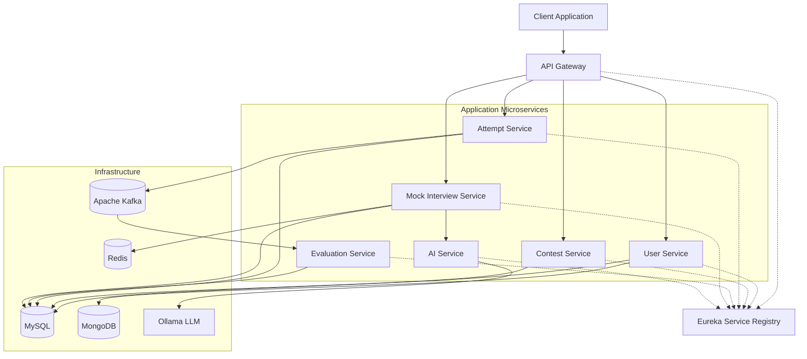

# ContestArena & EduPilotAI
### Microservices-Based Contest, Assessment & AI Mock Interview Platform

## Overview

This project combines **ContestArena** and **EduPilotAI** into a unified microservices-based platform for competitive assessments, contest management, and AI-powered interview preparation.

The platform uses independently organized services to separate business responsibilities, improve maintainability, and support the development and deployment of individual components.

It provides contest management, participant submissions, asynchronous evaluation, adaptive mock interviews, AI-generated questions, and personalized interview feedback.

The system is built using **Java, Spring Boot, Spring Cloud, Apache Kafka, Spring AI, Redis, MySQL, MongoDB, and Docker**, with centralized request routing and service discovery.

## Key Features

- **Contest Management:** Create and manage contests, schedules, visibility, participation, and contest lifecycle.
- **Attempt Management:** Handle participant attempts and contest submissions.
- **Asynchronous Evaluation:** Process contest evaluation and scoring through Kafka-driven communication.
- **AI-Powered Mock Interviews:** Generate interview questions and evaluate candidate responses.
- **Adaptive Interviews:** Generate follow-up questions based on previous questions and candidate answers.
- **Interview Feedback:** Provide an overall performance score, feedback, strengths, weaknesses, suggestions, and improved answers.
- **User Authentication and Security:** Secure application access using JWT-based authentication and authorization.
- **Microservices Architecture:** Separate business capabilities into independently organized services.
- **Temporary Interview Context:** Use Redis to maintain interview context and conversation history during an interview.

## Technology Stack

| Category | Technologies |
|---|---|
| Programming Language | Java |
| Backend Framework | Spring Boot |
| Microservices Infrastructure | Spring Cloud |
| API Routing | Spring Cloud Gateway |
| Service Discovery | Netflix Eureka |
| Asynchronous Messaging | Apache Kafka |
| AI Integration | Spring AI, Ollama |
| Relational Database | MySQL |
| Document Database | MongoDB |
| Temporary Data Storage | Redis |
| Authentication and Authorization | Spring Security, JWT |
| Database Migrations | Flyway |
| Containerization | Docker |
| Build Tool | Maven |
| API Testing | Postman |

## System Architecture

The application follows a microservices architecture in which each service is responsible for a specific business capability. The API Gateway serves as the entry point for client requests, while the Service Registry enables service discovery.

The Contest, Attempt, and Evaluation services support the contest workflow. The Mock Interview Service manages interview sessions, while the AI Service provides AI-powered question generation and evaluation. The User Service manages authentication and user-related functionality.

The Common Library contains reusable components shared across services.

### High-Level Architecture Diagram



*Note: This diagram represents the logical architecture. Exact routing, database ownership, Kafka topics, and service-to-service communication depend on the implementation and configuration of each service.*

## Microservices Overview

### 1. API Gateway

**Responsibility:** Central entry point for client requests.

- Routes incoming requests to the appropriate microservice.
- Provides a centralized location for gateway-level request handling and security integration.
- Uses service discovery to locate registered services where configured.
- Reduces the need for clients to communicate directly with individual services.

**Technology:** Spring Cloud Gateway, Spring Boot, Spring Security, JWT.

### 2. Service Registry

**Responsibility:** Service discovery and registration.

- Maintains the registry of available microservice instances.
- Allows services to discover one another without relying exclusively on hardcoded instance addresses.
- Supports service communication in a distributed environment.

**Technology:** Netflix Eureka, Spring Cloud.

### 3. User Service

**Responsibility:** User identity, authentication, and profile management.

- Handles user registration and authentication.
- Supports JWT-based authentication and authorization.
- Manages core user information using a relational database.
- Stores additional profile information in MongoDB.

**Technology:** Spring Boot, Spring Security, JWT, MySQL, MongoDB.

### 4. Contest Service

**Responsibility:** Contest creation and lifecycle management.

- Manages contest details, visibility, and scheduling.
- Controls contest lifecycle states.
- Supports contest participation and related business rules.

**Technology:** Spring Boot, MySQL, Flyway.

### 5. Attempt Service

**Responsibility:** Contest participation and submission management.

- Handles participant attempts and submissions.
- Enforces relevant attempt and participant constraints.
- Integrates with the asynchronous evaluation workflow through Kafka.

**Technology:** Spring Boot, MySQL, Apache Kafka.

### 6. Evaluation Service

**Responsibility:** Contest submission evaluation and scoring.

- Processes evaluation requests originating from the contest workflow.
- Supports asynchronous processing through Kafka.
- Handles evaluation and scoring-related business logic.
- Persists relevant evaluation data.

**Technology:** Spring Boot, Apache Kafka, MySQL.

### 7. Mock Interview Service

**Responsibility:** Interview session management and orchestration.

- Supports coding interviews and normal interviews.
- Manages interview configuration, question limits, and duration.
- Coordinates adaptive question generation through the AI Service.
- Maintains temporary interview context and conversation history in Redis.
- Requests a final overall interview evaluation after the candidate completes the interview.
- Stores interview results in MySQL.

**Technology:** Spring Boot, Spring AI integration, Redis, MySQL.

### 8. AI Service

**Responsibility:** AI-powered interview intelligence.

- Generates initial interview questions.
- Generates adaptive follow-up questions using the interview configuration and previous question-answer history.
- Evaluates candidate responses.
- Produces overall performance feedback and suggested improved answers.

The AI Service integrates with an Ollama-hosted language model to generate responses.

**Technology:** Spring Boot, Spring AI, Ollama.

### 9. Common Library

**Responsibility:** Reusable components shared across microservices.

- Shared JWT-related utilities and security components.
- Common exception handling components.
- Reusable classes and utilities required by multiple services.

The Common Library reduces duplication and promotes consistency across the codebase. It is a shared code dependency, not an independently running microservice.

## Service Communication

The platform uses different communication mechanisms according to the purpose of each interaction.

| Mechanism | Purpose |
|---|---|
| HTTP/REST | Request-response communication between clients and services, and between services where configured |
| Spring Cloud Gateway | Routes incoming client requests |
| Eureka | Service registration and discovery |
| Apache Kafka | Asynchronous communication for contest evaluation |
| Redis | Temporary storage of interview context and conversation history |
| MySQL | Relational persistence for application and business data |
| MongoDB | Storage of additional user profile information |
| Spring AI and Ollama | AI-powered question generation and response evaluation |

### Synchronous Communication

Synchronous communication is used when a service needs an immediate response to continue processing.

For example, the client sends a request through the API Gateway, which routes it to the relevant service. The Mock Interview Service also communicates with the AI Service to obtain interview questions when required by the interview workflow.

### Asynchronous Communication

Apache Kafka supports asynchronous communication between the Attempt Service and Evaluation Service.

This allows submission-related processing and evaluation to be decoupled rather than requiring every evaluation operation to complete within the original request-response cycle.

## Core System Workflows

### 1. Client Request and Authentication Flow

1. The client sends a request to the API Gateway.
2. The gateway routes the request to the appropriate service.
3. JWT-based security components validate the request according to the configured security flow.
4. The User Service handles authentication and user-related operations.
5. The relevant service executes its business logic and returns a response.

### 2. Contest Submission and Evaluation Flow

1. A contest is created and managed through the Contest Service.
2. A participant submits an attempt through the Attempt Service.
3. The Attempt Service initiates the evaluation workflow using Kafka.
4. The Evaluation Service consumes the relevant evaluation message.
5. The Evaluation Service processes the evaluation and scoring logic.
6. The resulting evaluation data is persisted and made available through the application's configured result-access flow.

Kafka provides asynchronous decoupling between submission handling and evaluation processing.

### 3. Adaptive Mock Interview Flow

1. The candidate configures an interview, including the target role, experience level, instructions, question limit, and duration.
2. The Mock Interview Service requests an initial question from the AI Service.
3. Interview context and question-answer history are maintained temporarily in Redis.
4. The candidate submits an answer.
5. The Mock Interview Service uses the interview context and previous responses to request an appropriate follow-up question from the AI Service.
6. The interview continues until the configured completion condition is reached.
7. The Mock Interview Service sends the interview questions and candidate answers for final evaluation.
8. The AI Service generates an overall score, feedback, strengths, weaknesses, suggestions, and improved answers.
9. The final result is persisted in MySQL, and temporary interview data is removed according to the implemented cleanup flow.

The adaptive design allows follow-up questions to depend on the candidate's previous responses rather than relying exclusively on a fixed, pre-generated list of questions.

## Data Storage Strategy

The platform uses different storage technologies according to the nature of the data.

| Technology | Usage |
|---|---|
| MySQL | Persistent relational data, including contest, attempt, evaluation, user, and interview result data |
| MongoDB | Additional user profile information |
| Redis | Temporary interview context and question-answer history |
| Flyway | Version-controlled database schema migrations |
| Kafka | Asynchronous event and message transport, not the primary application database |

Database ownership and the exact tables used by each service are documented in the corresponding service-level README files.

## Repository Structure

```text
.
├── ai-service/
├── api-gateway/
├── attempt-service/
├── contest-service/
├── evaluation-service/
├── mock-interview-service/
├── service-registry/
├── user-service/
├── common-library/
└── README.md
```

Each service has its own responsibilities, configuration, and implementation. The Common Library contains shared code used by services that depend on it.

*The directory names above are illustrative. Adjust them to match the actual repository directory names.*

## Security

Security is implemented using Spring Security and JWT-based authentication and authorization.

The architecture separates request routing from business logic and supports centralized gateway-level request handling. Services apply the security checks appropriate to their responsibilities and configuration.

Sensitive configuration, including database credentials, JWT signing keys, and service-specific secrets, should be supplied through environment variables or an appropriate secrets-management mechanism rather than committed to version control.

## Database Migrations

Flyway is used to manage version-controlled database schema changes. Migrations allow database changes to be tracked and applied consistently as the application evolves.

Each service's database schema and migration history should be documented in its individual README where applicable.

## Running the Project

The project consists of multiple services and infrastructure dependencies. A complete local setup requires the appropriate Java and Maven versions, service configuration, database instances, Redis, Kafka, and the Ollama runtime and model used by the AI Service.

Before starting the services:

1. Configure the required environment variables and application properties.
2. Start the infrastructure dependencies.
3. Start the Service Registry.
4. Start the application services and API Gateway.
5. Verify service registration, database connectivity, and the relevant application endpoints.
6. Test the contest and mock interview workflows.

Exact startup commands, ports, environment variables, and model configuration will be documented once the repository's actual configuration is consolidated.

## Future Documentation

This root README provides an architectural overview of the complete platform. Detailed implementation documentation will be maintained separately for each component.

Planned service-level documentation includes:

- Service purpose and internal architecture.
- API endpoints and request/response examples.
- Database schema and migrations.
- Service-to-service communication.
- Configuration and environment variables.
- Local setup and testing instructions.

## Summary

ContestArena & EduPilotAI is a unified microservices platform that brings together contest management, asynchronous evaluation, and AI-powered interview preparation.

By combining service separation, service discovery, asynchronous messaging, multiple storage technologies, and LLM integration, the platform provides a modular foundation for developing and maintaining contest and interview-related functionality.
